## Introduction

Few months ago I decided to start developing PortVM as a learning-portfolio project. PortVM is a stack based Halo2 ZKVM, initially made to cover a piece of EVM's core functionality. I used docs of already published zkEVMs like Scroll and Polygon as my learning resource.
At first I had a very abstract idea about how an EVM works, so I used those resources to learn the functionalities, high level design ideas, and other required stuff to keep the project objectives practical.

I thought the project's current state is suitable to be published as a portfolio piece, as an initial release of the project.  
Here is a list of opcodes supported in this ZKVM:

- READ(EVM POP)
- WRITE(EVM PUSH32)
- JUMP
- JUMPCON(JUMPI)
- JUMPDEST
- MSTORE
- MSTORE8
- MLOAD
- HALT
- ADD
- SUB 
- MUL
- DIV
- LT
- EQ
- AND
- OR
- XOR
- NOT
- BEGIN
- END
- CALL
- RETURN
- CALLDATACOPY
- RETURNDATACOPY

In this text, I will try to give a fair overview of the circuit, each chip, the design being used and limitations.

To understand this documentation, you have to know how Halo2 constraint system works and also you need to be familiar with stack based VMs. As said, this VM covers parts of the EVM and things like call context management have been handled EVM compatible. This article tries to introduce most of the PortVM functionalities and is not a general 0 to 100 explanation article, therefore chatbots can be helpful if anything does not make sense or feels too abstract.

To avoid making the wording unnecessarily awkward, this article sometimes explains the circuit as if actions and constraints happen in sequence. In a Halo2 circuit, however, they are simply constraints that must all be satisfied. there is no runtime execution order between them. For example, if I say that a value first goes to the CPU and is then looked up in RWTrace, I am describing the conceptual flow of the value, not an actual sequence of instructions executed by the circuit.

By convention, in this project chips are just blocks of constraints and columns, and a cell can only have a gate relation with another cell if they belong to the same chip.
If they are not in the same chip, they only can use lookup or copy constraint on each other.

Here are the names of available chips:

- ByteTable
- TxTable
- CPU
- ALU
- RWTrace
- RWState
- ROM
- CopyTool
- Output
- StaticTables(8 bit range, 16 bit range, AND, OR, XOR, NOT)

Only StaticTables and ROM are real Halo2 tables, the rest are made of advice, fixed and instance columns.

ByteTable and TxTable are instance(public) columns. User provides values for these two chips, and the witness generator generates the rest of the witness from them.

---

## ByteTable

ByteTable determines what opcode each PC(program counter) of each call id should have.
ByteTable is almost a constraintless chip and you are allowed to do "weird" things like setting two opcodes for a single PC,call_id. those are allowed because ByteTable has public columns and it can be independently verified by other parties. also, important weird things lead to a constraint violation on other chips(mostly CPU). The only constraint on ByteTable is a range check on value limbs.
Callid, PC and value are the 3 conceptual columns of the ByteTable. Value is split into 4 64 bit columns and it is used to specify what opcode we are choosing or what value we are trying to write on stack using the WRITE opcode.
Later, CPU will make lookups from its opcode/PC/call_id to ByteTable, so CPU rows are forced to follow the ByteTable.

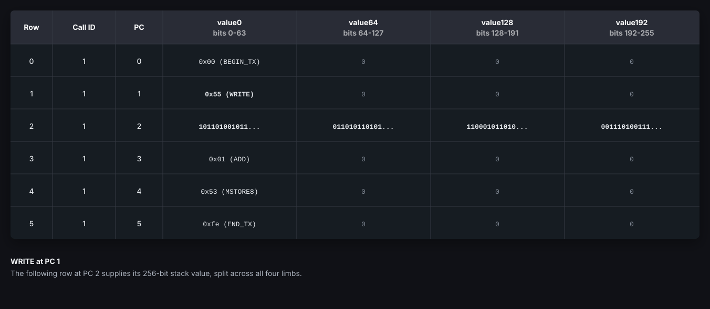

## TxTable

EVM receives transactions as input, processes them and determines what changes that tx should apply to Ethereum. PortVM aims to cover the initial functionalities of EVM but it doesn't start from the first brick.
On TxTable we try to fill the starting gap between an actual EVM and our VM. Like ByteTable, TxTable contains instance columns, and receives values that would be provided by a tx to an actual EVM.
On TxTable we have tags, indexes and values. Each tag stands for a meaning and indexes are counters for a set of values we can store under those tags. Like tag = 1 index = 0 value = 5, tag = 1 index = 1 value = 8, ...
Currently the only practical and logically important tags on TxTable are calldatalength and calldatavalues, both are provided to be used by the root call.

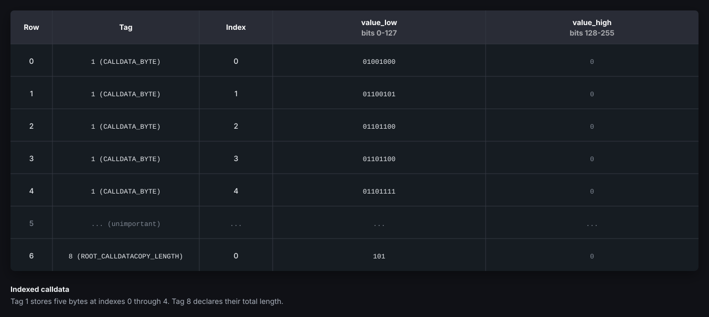

## CPU

CPU acts like a hub. Opcodes and PCs being used on CPU are looked up to ByteTable. CPU uses those opcodes to gate some other columns belonging to itself(for example, if the current CPU row's opcode is CALL, next row's RW counter should increase by 24).
Then based on the opcodes CPU will make lookups to other chips, and the "output" of the opcode is achieved. This was an abstract and general workflow of CPU.
Here is an example of a CPU chip, containing the conceptually important columns:

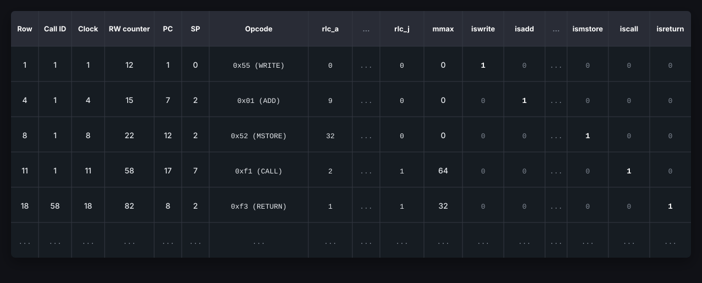

RWTrace is the chip that you can access stack, memory and call context values through lookups.
As said, each CPU opcode will trigger a lookup to different chips. For example on ADD opcode, we need to lookup from CPU rlc_a column to RWTrace to get stack's top value, and make another lookup to set rlc_b with stack's second to top value.
Then we will make a lookup from rlc_a, rlc_b, rlc_c to the ALU chip. ALU constrains the result of ADD using the linked rlc_a and rlc_b, and rlc_c will be equal to the output cell that is constrained inside ALU.
After that, we decrease the SP by 1 and set the stack's top to rlc_c using a CPU to RWTrace lookup so the next row's CPU SP will be decreased by one.

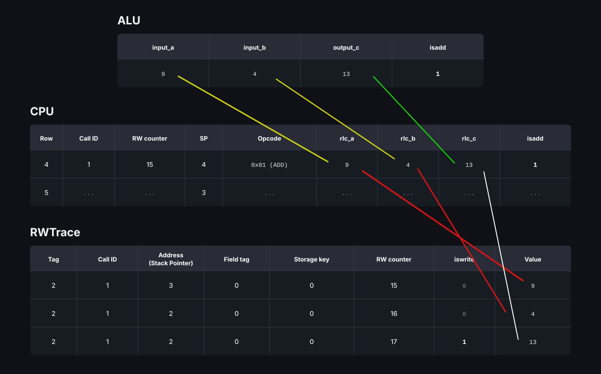

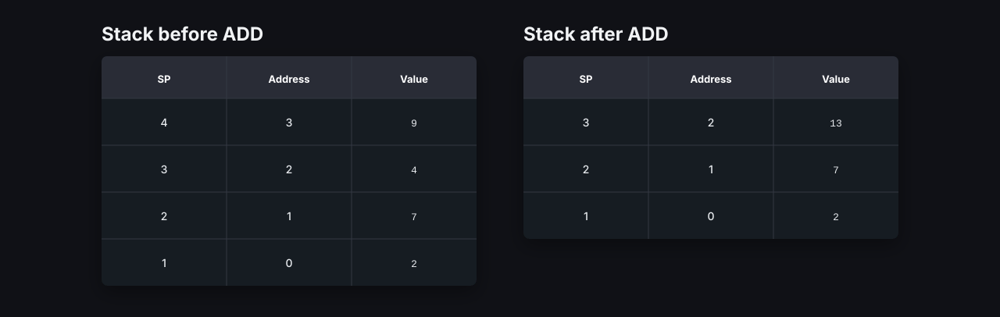

This is how different kinds of opcodes are managed (=> means lookup):

JUMP, JUMPCON(JUMPI), HALT: CPU only.  
The first two opcodes interact with RW chips, but their eventual goal is to modify the internal columns of CPU. JUMP changes the PC, while HALT triggers some constraints that activate certain attributes. For example, one of them keeps the PC the same for the next rows.

READ, WRITE: CPU => RWTrace  

ADD, SUB, MUL, DIV, LT, EQ, AND, OR, XOR, NOT: CPU => ALU, CPU => RWTrace

MSTORE, MSTORE8, MLOAD: CPU => ALU => RWTrace

BEGIN, END, CALL, RETURN, CALLDATACOPY, RETURNDATACOPY: CPU => RWTrace. By this lookup, we link the CPU values to RWTrace, and we are also able to modify our internal CPU columns correctly across different call contexts. So RWTrace and CPU both get affected.

## ALU

ALU (Arithmetic logic unit) does two different things. It constrains the arithmetic opcodes, and manages my VM's memory bytes.  
These are the arithmetic opcodes:  
ADD, SUB, MUL, DIV, LT, EQ, AND, OR, XOR, NOT.  
On the arithmetic part, ALU is made from 4 row chunks, each chunk represents an operation. So the ALU constrains input_a and input_b with output_c, based on the active opcode inside the chunk.

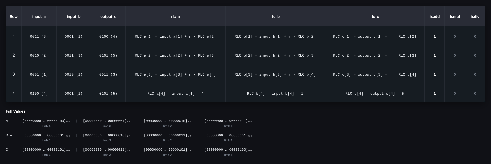

EVM supports 256 bit words, while the field being used for the circuit is a 254 bit number. So we have to split each actual number into 4 64(or 2 128 and many others) bit values and manage them separately, and that's why we handle a single value and operation in 4 rows. As you can see, this happens for each input_a, input_b and output_c.

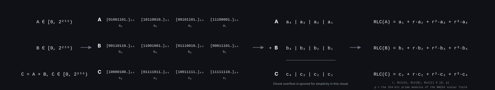

We fit the 256 bit number inside a 254 bit finite field by doing:
row_1(first and smallest 64 bit) + row_2(second 64 bit) * r + row_3(third 64 bit) * r^2 + row_4(fourth 64 bit) \* r^3. Here, r is the random challenge value being generated during the proof creation phase.
With this, the 256 bit number is stored and compacted safely inside a single cell. These compacted values are the ones used in lookups involving CPU rlc_[] columns and the RW table's stack rows. See them as symbols representing the real number that are unique for each value and we can access the real value behind them on the ALU chip.  
So the constraint flow is: compacted CPU inputs go into the ALU, where they are extracted into their four 64 bit limb form. The ALU calculates (constrains) the output based on the active opcode, and the output is ready in its four row form.
The output gets compacted, and the result is sent back to CPU into its proper rlc\_[] column.

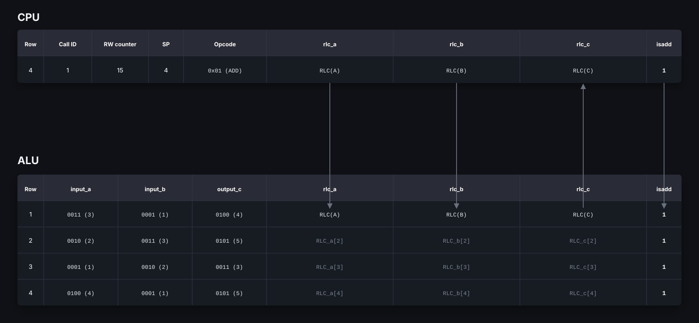

Up to here I was talking(!) about the first task ALU chip can do. The other part is handling memory bytes.
The memory handling part is made from 32 row chunks, and it should constrain a compacted value into 32 rows using the same mentioned method. Each row contains an 8 bit value(32 \* 8 = 256). MLOAD, MSTORE and MSTORE8 lookup these 32 row values into RWTrace and do their job.

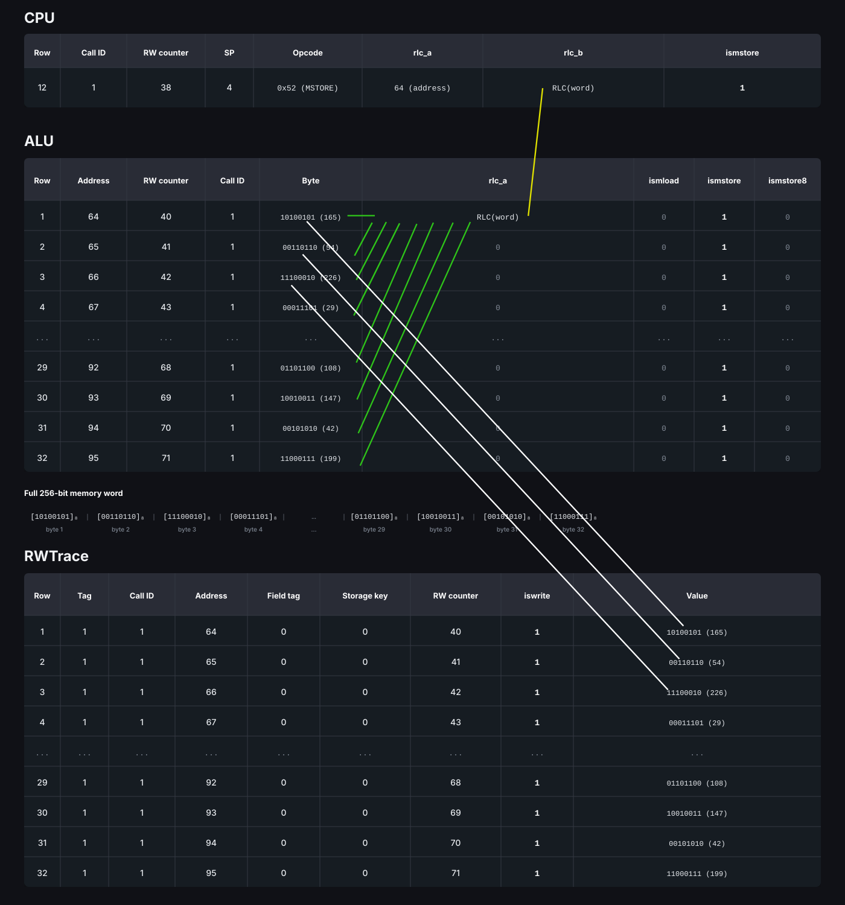

And the lookup flow is: CPU => ALU, ALU => RWTrace

## RW chips

This section includes RWTrace and RWState.
These two chips are the most similar to their Scroll zkEVM counterparts among all the chips being developed in this project.
PortVM currently supports stack, memory and call context. RW chips exist to make a constrained record of our VM's stack, memory and call context.

Stack gets updated with READ and WRITE opcodes. READ removes the stack's top value, WRITE adds a value to the top of stack.
MSTORE, MSTORE8, MLOAD are memory opcodes. On MSTORE, ALU gets the compacted value from CPU, constrains that into 32 8bit values, then writes them to the targeted memory addresses by looking up to RWTrace. Each address belongs to one byte. MSTORE8 does the same thing but it is limited to 1 byte, not 32. MLOAD picks 32 successive bytes from memory and turns them into a compacted value(using ALU again), then writes the compacted value into the stack.

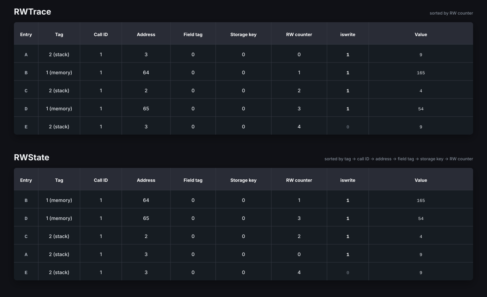

So basically RWTrace is sorted by RW counter, and RWState is sorted by tag(determines whether this row belongs to stack, memory or call context), callid, address, field tag(call context related, 0 on memory and stack) and RW counter. Each row that exists in RWTrace should exist in RWState and vice versa, this is constrained.
By using these two chips, alongside recording memory and stack, we are trying to achieve two specific soundness attributes: prevention of adding arbitrary RW operations and having reliable READ and MLOAD opcodes.

The constraints of RWTrace force all RW counters to be unique, and every row should increase the RW counter by 1 compared to the previous row.
Notice that there is no gap between RW counters on RWTrace.
Each opcode requires a fixed number of RW rows. A WRITE only needs one, just writing a row to stack, and an ADD needs three, two reads from stack and one write to stack. So if each chip that triggers RW operation(CPU and ALU) can send fully constrained lookups with determined and unique RW counter to RWTrace and eventually all available RW counters are covered, there is no gap for the user to add arbitrary RW rows in between.

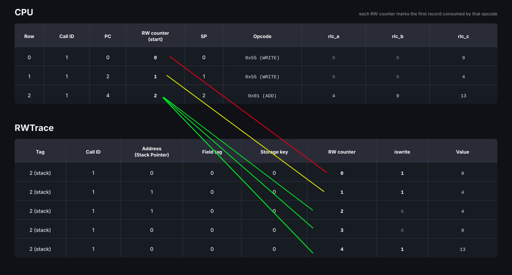

Now to achieve reliable READ and MLOAD, we need more than a chip sorted by RW counter. If we make a WRITE on address 5 at RW counter 3, we have no way to make a constraint to READ address 5 on RW counter 10 on RWTrace. Eventually, we want rows with the same key combination (callid, tag, address, ...) to be neighbors in RWState and sorted by rw counter. With this, if there is a READ constraint, we can gate the value to its previous row.

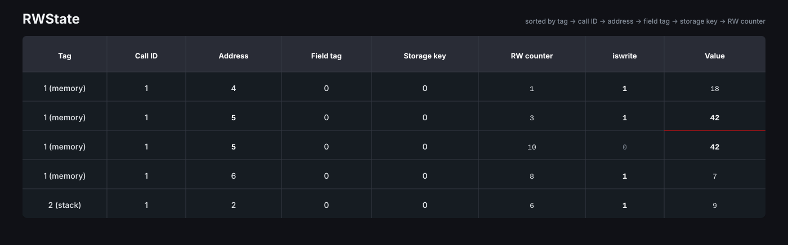

Later I make sure these two chips contain the same rows, and the circuit is sound!

we could entirely avoid using RWTrace by adding two additional columns to RWState, but due to some design decisions I decided to follow Scroll's implementation.

## ROM

CPU opcode flags send some lookups to ROM, for some required constraints.

## CopyTool

RETURN, RETURNDATACOPY and CALLDATACOPY opcodes require us to perform a dynamic number of memory reads and writes across different call ids and addresses. Since we are trying to constrain things, we cannot simply ask for a different number of lookups on each proof generation. Therefore there is an additional chip to achieve this ability, called CopyTool. 
Basically, it receives the call ids and memory address ranges it needs to read from and write to, and constrains those reads and writes using RW chips. Note that read and write here are not MLOAD and MSTORE or stack READ and WRITE operations, they are just flags on RW chips that determine whether the circuit should read a value or write for that row. MLOAD and MSTORE themselves are made from 32 RWTrace rows, each reading or writing one byte (8 bit value). CopyTool can also read values from TxTable and write it to memory.
So, CopyTool constrains this process: read from address 3,4,5 of call ID 5's memory and write on address 10,11,12 of call ID 10's memory.

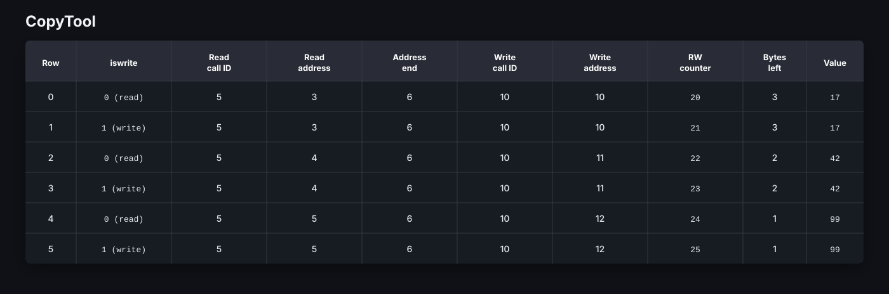

## Output

On this ZKVM, the user provides public inputs to the witness generator, and the witness generator calculates and fills the rest of columns automatically. The Output chip contains instance columns filled by the witness generator. It contains the root call's memory and stack RW rows. This root call starts with BEGIN_TX, the first CPU row. When the proof is generated, the prover provides these public input and output values alongside it, allowing the verifier to cheaply verify that the input leads to the provided output on this VM.

## StaticTables

Across the circuit, we need StaticTables to perform some constraints.
You cannot simply check if a value is inside a specific range and StaticTables are required. For example you want to check if the value is 16 bit, you need a table column that contains values from 0 to 2^16 - 1, and then check if your value exists in one of those table rows with a lookup. With a single 16 bit table, you can have 32, 48, 64 ... bit range checks too. For a 32 bit range check, you can constrain that value into two parts and have a constraint `value = part1 + part2 * 2^16` and make lookups from part1 and part2 to the 16 bit range table. Also, you can compare two values with each other. Assume A and B are 16 bit values. If A > B, B - A will be a very large value since the circuit operates in a finite field. So with a flag you can determine which value is equal or bigger to other:  
flag * (A - B) + (one - flag) * (B - A) => 16 bit range.  
If flag is one, A is bigger or equal since the result should fall into 16 bit range and vice versa.  

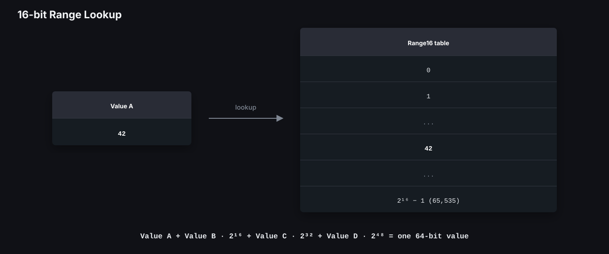

The same method is useful on bitwise operators. To constrain for example, an AND constraint on 64 bit values(input1, input2 and output) we can have a 3 column table that has all combinations of AND 8 bit inputs and output which will be (2^8)^2 = 2^16 rows. Then we split each 64 bit value(input1, input2, output) into 8 bit values and constrain them with `value = part1 + part2 * 2^8 + ...` and lookup each row against a row of table columns.

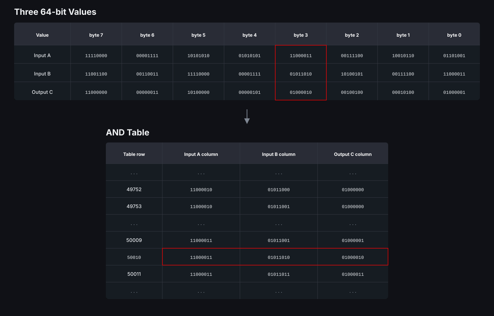

---

## Limitations and vulnerabilities

PortVM currently only supports successful paths. RETURN is the only supported termination opcode. exceptional halts, REVERT and other termination methods do not exist.
The circuit won't trigger an exceptional halt on required failure cases, it ignores them or forces them to be successful. The ignored cases mostly cause a circuit violation later in the circuit.
Among currently covered EVM functions on PortVM, stack underflow(not constrained) and valid jump destination(constrained and forced to be valid) need exceptional halt.
There are a few implementation deviations compared to the original EVM mentioned below. If these deviations are fixed, more exceptional halt cases will need to be covered.

### Deviations

PortVM does not limit the stack size, while the EVM limits it to 1,024 items. A stack overflow exceptional halt will be required if this size limit is implemented in PortVM.  
DIV by zero is rejected on PortVM but it returns 0 on EVM.  
0 length copy is globally rejected by PortVM, while EVM allows it on RETURN, RETURNDATACOPY, CALLDATACOPY and ...  
EVM triggers an exceptional halt on out of bounds RETURNDATACOPY, while PortVM pads the out of bounds units with 0.  
Jump destination is forced and constrained to be correct in PortVM, while an invalid jump destination triggers an exceptional halt in the EVM.  

There is also a discovered and unresolved vulnerability on the circuit. On the CopyTool chip, if the rows with active switch reach the last active selector in the middle of a copy chunk, an attacker can smuggle some arbitrary RW rows. 
There are a few more small deviations on PortVM, which are not important and I didn't mention them.

---

## AI impact on project development

Obviously PortVM wasn't meant to be a production grade project, and I started it for learning and portfolio purposes. And considering the fact that there are already a few well documented ZKVMs publicly available on the internet, and also considering the different nature of circuit development compared to ordinary programming, there was no direct circuit implementation by AI on this project.  
Almost all of the gathered information from related sources on the internet(like ZKVM docs) across the project was proxied and interpreted by AI.  
AI had a valuable impact on finding some bugs and edge cases across the project.  
All of the Rust executables on this project are AI generated. Using AI dramatically decreased the development time of some none circuit Rust functionalities, like the witness generator, from a few months to a few weeks.  
Also the Usage Doc that can teach another AI how to use this project through CLI is AI generated. Only the testing and verification were on my side.  

That's it!
